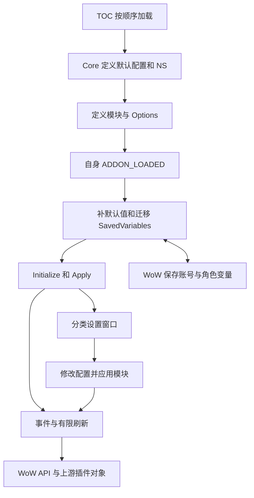

# 当前架构

审计日期：2026-10-20，更新于 2026-10-21；审计基线 0.3.18，当前本地代码版本 0.3.21。代码存在不等于已提交、发布或游戏内验证。Git 和当前任务见 [HANDOFF](HANDOFF.md)，稳定行为见 [SPEC](SPEC.md)，规划见 [PRD](PRD.md)。

## 运行环境与启动

0.3.21 目标显隐稳定性补充：Bounds 的相邻判断容许 2×GAP 的水平间距，修正头像紧邻而非重叠时漏算下沿；Collect 对玩家、目标及目标的目标和已布置子框不按可见性释放障碍。仅显隐变化不会改变测量区域；未知/受限制坐标依旧跳过。

这是 WoW 正式服客户端内的 Lua 插件，没有服务器、数据库或网络服务。TOC 声明 ShestakUI、BagBrother、Bagnon、Details 为可选依赖；适配器检查对象是否可用。MCP/连接器只是可选开发工具，不是玩家运行依赖。

定位：`Cuniel_plus/Core.lua` 的 NS:RegisterModule 和 ADDON_LOADED 回调；`Cuniel_plus/Cuniel_plus.toc`；`Cuniel_plus/Options.lua` 的 NS:CreateOptions。Core 先调用各模块可选 Initialize，再 Apply，遍历使用 pairs，没有显式依赖排序。TOC 定义顺序不保证 Apply 顺序。

## 模块职责与调用关系

以下路径相对 `Cuniel_plus/Modules/`。当前 14 个注册模块，三个共享帮助文件；详细默认值仅在 SPEC 维护。

| 文件 | 责任与依赖 |
| --- | --- |
| Numbers.lua | 包装 ShestakUI ShortValue；游戏缩写接口、恢复原函数，未覆盖所有独立格式化模块 |
| FPS.lua | 独立帧显示帧数、拖动和保存位置，约半秒刷新 |
| GoldColors.lua | 已知角色职业缓存及 ShestakUI 金币提示着色，可导入运行时 BrotherBags |
| ItemLevel.lua | 单位提示内部装等、检查节流和缓存；上游原生装等开启时让位，提供主动切换并重载 |
| ItemCountFilters.lua | NS.ItemCountFilters，类别/ID 过滤帮助函数，不独立注册 |
| ItemCounts.lua | 读取可用容器及装备，保存角色/战团快照，过滤后在提示框展示 |
| Sorting.lua | NS.Sorting，移植原排序键和反向目标格，有限等待/移动；由工具条调用 |
| Deposit.lua | NS.Deposit，在用户点击路径执行带食物及保留 ID 保护的战团存放 |
| ShestakBags.lua | Stuffing 位置偏移及战团存放按钮适配；位置开关不控制存放适配开关 |
| SlotLabels.lua | Stuffing.buttons 上独立 FontString、品质过滤；安全钩住 SlotUpdate |
| MapEscape.lua | 明确窗口名单登记 UISpecialFrames，按需加载补登记，/cplusesc 诊断 |
| Bagnon.lua | 外部工具条调用 Sorting/Deposit，复用当前角色自动售卖；/cplusdiag 有限记录 |
| Quiet.lua | 有限时段处理已识别启动宣传，不清空正常聊天或隐藏报错 |
| ArenaSpam.lua | 竞技场短时间重复加入消息过滤，保留首次 |
| ChatTabs.lua | 每角色首次备份/清理永久自定义页，创建中文页与恢复入口 |
| DetailsLayout.lua | 几何规划与 Details 实例适配；右侧可用高度 6:4 预算、完整行尺寸、位置恢复与有限外部纠偏 |
| Readability.lua | 高分辨率单位文字/聊天标签最低字号，默认仅 Mac；定向 SetFont 后钩子，保留较大字体与会话恢复 |

0.3.21 字号职责：Core 的 chatTabs.labelSize 默认 14；ChatTabs 在已初始化角色的三个具名标题上维护弱引用字号记录与局部 SetFont 后钩子，不修改正文或重建窗口，关闭/恢复按会话记录还原。Readability 查询 ChatTabs:IsManagedLabel 并让位，避免通用最低字号与独立标题设置互相争抢；未管理的标签沿用原通用补偿逻辑。

Options 直接创建 WoW Frame，没有第三方选项框架；基础 820×590、五分类及显示页四子页（新增字体可读性），内部滚动，可用时调用 ShestakUI 皮肤。搜索、独立图标样例和恢复本页默认未实现。

## 数据模型与持久化

- `CunielPlusDB`：TOC SavedVariables，账号共享配置、位置、职业缓存、物品缓存和诊断；NS.db 引用该表。schema version=8，与插件版本不同。Core 只补缺失/无效默认值，并有旧 FPS 迁移。
- `CunielPlusCharDB`：TOC SavedVariablesPerCharacter；NS.charDB 引用。chatTabs 保存初始化/停用状态和首次有效自定义聊天页备份；无聊天内容或输入历史。
- itemCounts.characters：服务器与角色名组合键，分别缓存背包、装备、已读取个人银行。itemCounts.account 缓存战团银行，汇总仅计一次。装备过滤不删除原缓存。
- 读不到银行保留快照，读到空银行清除旧数量；不包含邮箱、公会银行或未采集角色实时库存。BrotherBags 只导入已加载运行时数据，不能任意读另一个插件磁盘缓存。
- 用户主动装等修复修改实际 ShestakUI 持久配置并重载；自动售卖复用其当前角色设置。
- Details 通过实例位置接口保存；本模块 originals 原位置备份仅在当前 Lua 会话内，不提供跨重载完整恢复或吸附组恢复保证。

## 核心业务流程

物品数量：容器/装备/银行事件 → 合并扫描可读数据 → 更新快照 → 提示框取得物品 → 过滤 → 追加角色与战团数量。提示生命周期内去重，不接管右键或新增装备检查。

战团存放：Bagnon/Stuffing 用户按钮 → 检查有效银行、战斗、光标、整理状态 → Deposit 保留食物、名单和未知分类 → 在点击路径请求存放。数量隐藏名单与存放保留名单独立。

整理：工具条 → 原版键排序 → 按用途包和当前容器范围反向放置 → 检查锁定、超时及终止事件。当前普通包扫描 4..0；材料包/用途包覆盖仍应实际验证，不将 SPEC 兼容目标直接当作验收结果。保留原版自带优先键，未增加早期讨论的专业/大版本自定义分组。

装等：核对悬停对象 → 缓存或节流请求 → 收到结果再核对对象 → 原提示框内部显示，不无限追加等待行。

Details 0.3.18：有效缩放统一坐标 → 检测重叠/越界/已识别障碍 → 正常保留，否则搜索并排/上下空位 → 无空位提示。移动前 CreatePositionTable，移动后 SaveMainWindowPosition；关闭使用 RestorePositionFromPositionTable。战斗延后，监听显示/尺寸/拖动停止和 UI 变化，不按 6:4 改高度/行数。

Details 0.3.19 历史方案曾用视口 64%/62% 限定堆叠区域，用户实测仍高于目标框、图标预留不足；0.3.20 已替换。当前 Bounds 读取目标框及相邻头像/目标的目标下沿，底部线 BottomPanel、实际动作条按钮/holder、小地图 MinimapAnchor 与 ButtonCollectFrame；两列图标及间距整体预留。目标隐藏仍读取布置好的锚点；缺失或受限制坐标跳过，不按视口比例猜测。

Plan 接收测量边界，在其中扣除其他障碍形成有限自由矩形；优先尝试同宽并排（伤害左、治疗右），以初次可读宽度判断是否足够，避免自身缩放后反复切换。不足则等宽堆叠（伤害下、治疗上），按 6:4 高度预算扣标题取整完整行。宽高都留在同一区域；通过 Details:SetSize 调整裁行，不改字体/统计内容。新锚点移动/尺寸/可见性、目标切换及已有窗口/战斗事件合并检查；边界变化重置冲突计数，持续外部抢位置仍最多四次。保护判定、原始会话位置/尺寸恢复保持。

字体当前 0.3.19：Readability 对已知 oUF 单位文本字段和聊天标签补足最小字号，记录原始字体/大小/描边。只钩住目标 FontString 的 SetFont，解决上游鼠标进入时重设标签字号；不开全局字体钩子。默认仅 Mac 且 mult < 0.85，最低 12（10–20），战斗延后。Windows 默认保持原样，可主动取消平台限制；关闭仅在当前字体仍是本模块应用结果时恢复，不清除持久设置或改上游配置。

0.3.21 右锚增量：保留几何安全 GAP=8，双窗贴合间距单独 PANE_GAP=2。Plan 采用已保存的初始可读宽度，横向先定位右侧治疗，再定位左侧伤害；窄空间可收窄到可读下限但不放大铺满剩余区，堆叠双窗右界相同。只使用触及测量右边界的自由矩形，左侧空白保留，空间不足提示；模式/宽度比较与原始会话恢复继续验证。

## 权限、集成和技术约束

不修改上游磁盘文件，但运行时适配仍依赖具体对象结构。secret 值不可直接运算、比较或索引；战斗保护不可绕过，ESC 登记不能解除 Hide 限制。只读展示不抢占物品点击。SavedVariables 有个人资料，调试样本须脱敏；迁移前保护有效备份、明确并验证恢复。

测试是 Python + Lupa Lua 5.1 的 WoW API 模拟，不是游戏安全环境。`tools/package.py` 递归打包源码目录，无精细白名单。`tools/release_notes.py` 默认只校验，--backfill 远程修改历史正文。工作流监听根 README 等文档路径，推送文档也可能触发发布；操作授权见 AGENTS。

## 已知局限与规划

1. pairs 初始化无依赖排序或逐模块失败隔离；没有依据在本任务重构。
2. 私有上游结构/吸附组易受版本影响。Mac 已反馈 Details 遮挡和战斗中央移动，实际移动来源待查，不能只因本模块战斗延后便排除其他路径。
3. 测试残留 work/lua-test-v036 搜索路径，依赖未精确锁定；无 Windows/macOS CI 矩阵。发布测试有客户端构建号常量。
4. 当前没有独立完整数值模式或全面数字覆盖；Mac 的上游高分辨率字体缩减路径已核对，定向补偿和 Details 6:4/行数已写入 0.3.19 并通过模拟，仍待真实客户端验证。外部战斗移动的唯一来源未确定。
5. 未发现根 LICENSE，Sorting 有上游来源说明；许可与署名需核对，不能自行编造授权。
6. 游戏保护、字体、高 DPI、真实布局不能由模拟测试证明。当前任务最新授权见 HANDOFF，未交付设计仍按 PRD 区分。
